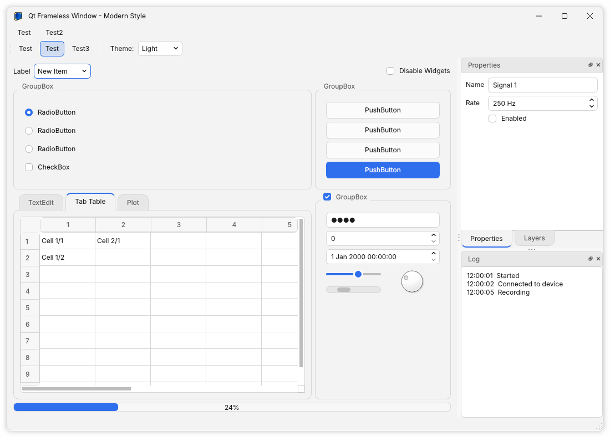
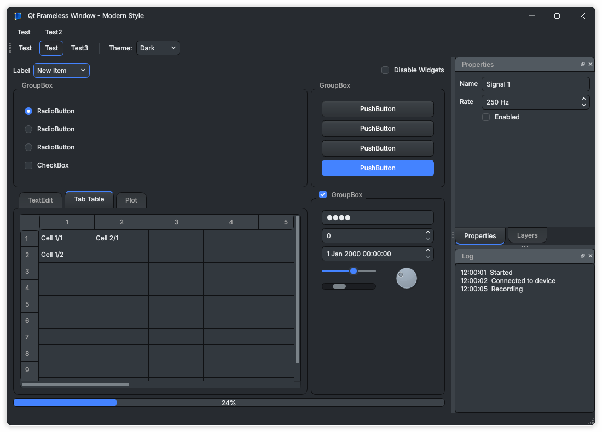
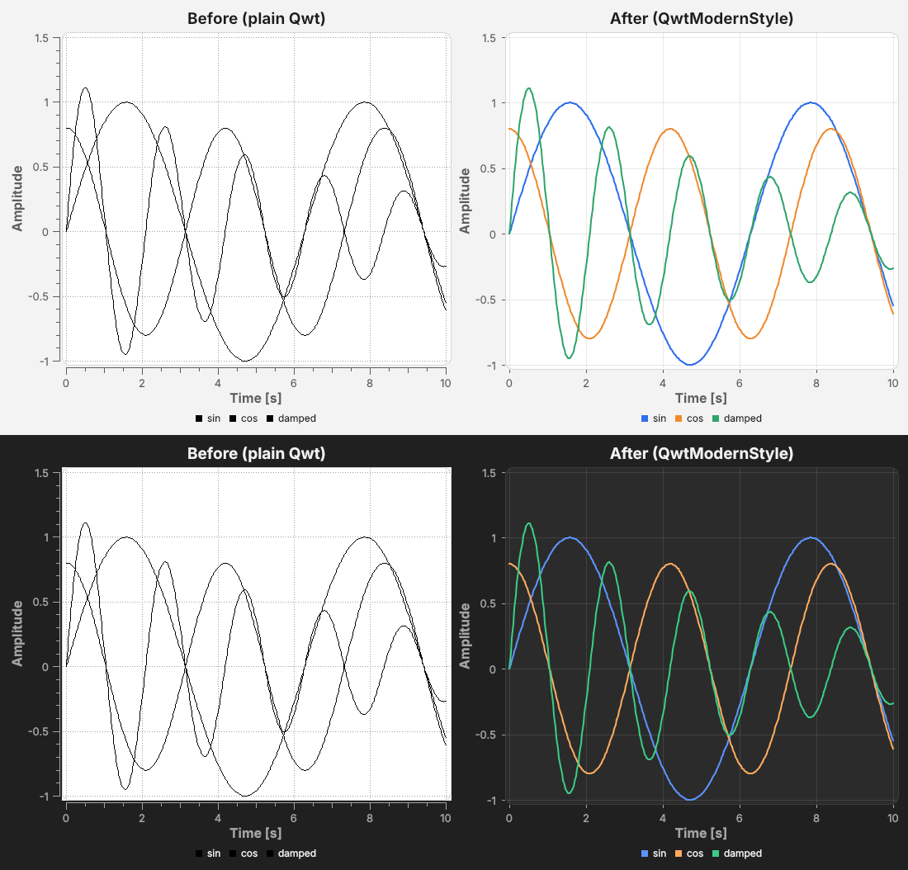

# Qt Frameless Window with Modern Style

A frameless Qt 6 window with its own title bar, rounded corners and a soft shadow, plus **ModernStyle**: a flat, rounded Qt Widgets style with a **light and a dark theme that follows the operating system**. Put your existing `QMainWindow` inside and it gets the modern look without other changes.

| Light | Dark |
|---|---|
|  |  |

Version 2 of this fork brings the original [Qt-Frameless-Window-DarkStyle](https://github.com/Jorgen-VikingGod/Qt-Frameless-Window-DarkStyle) (Qt 5, qmake) to **Qt 6 and CMake**.

## Features

**FramelessWindow**
- Own title bar: icon, title, minimize / maximize (restore) / close buttons drawn in code, so they're sharp at any display scaling and follow the theme. The close button turns red on hover.
- **Native moving and resizing**: dragging the title bar or an edge hands over to the window system (`QWindow::startSystemMove()` / `startSystemResize()`). That gives native behaviour like snapping to screen edges, multi-monitor moves, and works on Wayland. Where the window system can't (macOS for resizing, some X11 window managers), the window moves or resizes itself.
- Resize from all four edges and corners, with the matching mouse cursors.
- Double-click the title bar to maximize or restore. Dragging a maximized window restores it under the mouse.
- Rounded corners and a shadow, none of either when maximized. Taskbar minimize and the window menu (Alt+Space) keep working on Windows.
- Takes its title and icon from the content (e.g. your `QMainWindow`) and follows later title changes.

**ModernStyle**
- **The dark theme matches [Bootswatch Slate](https://bootswatch.com/slate/)**, so a Qt app and a Bootstrap web front end using Slate look alike: the same background (`#272b30`), panels, near-black borders, grey text, and Slate's gradient buttons and tabs (raised, sunken on hover, darker when pressed). The values come from Slate's own Sass (`_variables.scss`, `_bootswatch.scss`) and were checked pixel by pixel against Slate rendered in a browser. The light theme is ModernStyle's own.
- Light and dark themes, flat and rounded, with one accent colour for selections, default buttons, focus, sliders, progress bars, check boxes and radio buttons.
- `Theme::System` (default) follows the OS light/dark setting and **switches live when it changes** (Qt 6.5+; older Qt picks at start-up).
- Switch at run time with `setTheme()`, change the accent with `setAccentColor()`.
- Themes by name, e.g. for a settings dialog or a command-line option: `getThemeNames()` gives `"System", "Light", "Dark"`, `ModernStyle::themeFromName("dark")` the theme (any case; `Theme::Invalid` for an unknown name), `ModernStyle::themeName(theme)` the name back.
- Splitter handles and the gaps between dock widgets have grip dots and turn the accent colour under the mouse; slider tracks and scroll bar handles are drawn in a colour that stands out on both the window and panels.
- Based on Qt's Fusion style, plus one readable style sheet (`modernstyle/modernstyle.qss`) with named colours (`@accent`, `@border`, ...) you can edit.
- Check boxes, radio buttons and arrows are drawn in the theme's colours at 1× and 2×: no image files, no Qt SVG module needed.
- **Dock widgets are panels like Slate's cards**: a lighter body (`$card-bg`, `#32383e`) and a header-coloured title bar (`$card-cap-bg`, `#515960`) with rounded top corners and clear close / float buttons. Splitter handles, the gaps between dock widgets and the menu and toolbar separators use `palette(alternate-base)`.
- Toolbar buttons light up on hover like push buttons, checked ones included (a checked button gets brighter under the mouse).
- Long combo box lists scroll: `style->setComboPopupMaxHeight(240)` caps every drop-down at 240 px, and `combo->setProperty("popupMaxHeight", 120)` sets a limit for a single combo box. Without either, `QComboBox::maxVisibleItems()` (10) applies.
- `DarkStyle` still exists: `QApplication::setStyle(new DarkStyle)` keeps working (always dark).

## Requirements

- Qt **6.2** or newer (Widgets). Following the OS theme live needs Qt **6.5**.
- CMake 3.16+ and a C++17 compiler.
- Windows, Linux (X11 with a compositor, or Wayland), macOS.

## Build the demo

```bash
cmake -S . -B build -G Ninja -DCMAKE_PREFIX_PATH=/path/to/Qt/6.x.y/<kit>
cmake --build build
./build/QtFramelessWindowDemo                 # Windows: build\QtFramelessWindowDemo.exe
./build/QtFramelessWindowDemo --theme dark    # or light / system
```

The toolbar's **Theme** box switches between System, Light and Dark while it runs. `--screenshot file.png` saves a picture of the window and exits (that's how the screenshots above are made).

## Use it in your application

Add this repository to your project (a git submodule, a copy, or `FetchContent`) and link the library:

```cmake
add_subdirectory(third_party/Qt-Frameless-Window-DarkStyle)
target_link_libraries(MyApp PRIVATE FramelessWindow::FramelessWindow)
```

or without copying it:

```cmake
include(FetchContent)
FetchContent_Declare(FramelessWindow
    GIT_REPOSITORY https://github.com/cms26/Qt-Frameless-Window-DarkStyle.git
    GIT_TAG master)
FetchContent_MakeAvailable(FramelessWindow)
target_link_libraries(MyApp PRIVATE FramelessWindow::FramelessWindow)
```

The demo is only built when this is the top-level project (`FRAMELESSWINDOW_BUILD_DEMO`).

```cpp
#include "framelesswindow.h"
#include "modernstyle.h"

int main(int argc, char *argv[])
{
    QApplication app(argc, argv);

    auto *style = new ModernStyle;               // follows the OS; or ModernStyle(ModernStyle::Theme::Dark)
    QApplication::setStyle(style);               // the application takes ownership

    FramelessWindow window;
    window.setContent(new MainWindow);           // your QMainWindow (or any widget)
    window.resize(1000, 700);
    window.show();
    return app.exec();
}
```

At run time:

```cpp
style->setTheme(ModernStyle::Theme::Light);      // System, Light or Dark (Invalid is ignored)
themeBox->addItems(style->getThemeNames());      // "System", "Light", "Dark"
style->setTheme(ModernStyle::themeFromName(settings.value("theme").toString()));
style->setAccentColor(QColor("#7c3aed"));        // any colour
connect(style, &ModernStyle::themeChanged, this, [](bool dark) { /* e.g. swap your own icons */ });

window.setResizable(false);                      // fixed size, no resize cursors
window.titleBar();                               // the title bar widget, e.g. to add widgets to it
```

You can also use only one of the two parts: `ModernStyle` works with ordinary windows, and `FramelessWindow` with any other style.

### Changing the look

The style sheet is [`modernstyle/modernstyle.qss`](modernstyle/modernstyle.qss). Colours are written as `@name` and filled in from the current theme. The names and their light/dark values are in `themeColors()` at the top of [`modernstyle/modernstyle.cpp`](modernstyle/modernstyle.cpp), with the Slate variable each dark colour comes from. Buttons and tabs use `@buttonFill`, `@tabFill` and friends (`themeFills()`): plain colours in the light theme, Slate's gradients in the dark one. Change values there, or add your own rules to the sheet; it is compiled in as a resource.

If your application sets its own style sheet with `qApp->setStyleSheet()`, it replaces ModernStyle's. Set style sheets on your own widgets instead (`myWidget->setStyleSheet(...)`), or append your rules to `modernstyle.qss`.

## Qwt plots

[Qwt](https://qwt.sourceforge.io) plots (6.2 or newer) get the same look in both themes:



Two parts do this:

- **The style sheet** gives the plot canvas a rounded frame and the theme's background, and the axes, title and legend the theme's text colours. It works for every `QwtPlot` automatically, with no Qwt dependency in this library.
- **`qwtmodernstyle.h`** (optional, header-only; include it where you use Qwt) styles what a style sheet can't reach: curve colours, the grid and the axes.

```cpp
#include "qwtmodernstyle.h"

QwtModernStyle::follow(plot, style);    // style the plot now and whenever the theme changes
```

It gives every curve a colour from a set that reads well on light and dark backgrounds, with 2 px antialiased lines. The grid becomes faint solid lines (one is added if the plot has none), and the axes lose their axis line and minor ticks. Leave parts out with options, e.g. `QwtModernStyle::follow(plot, style, QwtModernStyle::Option::All & ~QwtModernStyle::Option::CurveColors)` if your code colours its curves itself. `QwtModernStyle::seriesColor(index, dark)` gives you the colours for your own use (bars, markers). Call `apply()` again after adding curves.

Qwt caches what it draws, so a plot only shows a new theme after a replot. `follow()` does that for you. For plots you don't pass to it, call `plot->replot()` on `ModernStyle::themeChanged`.

The demo shows a **Plot** tab when CMake finds Qwt, e.g. winlibs' `qwt/6.2.0` on `CMAKE_PREFIX_PATH`. `--tab 2` opens it straight away.

## Upgrading from the Qt 5 version

| Before | Now |
|---|---|
| qmake: add `framelesswindow.qrc`, `darkstyle.qrc` and the include paths | CMake: `target_link_libraries(... FramelessWindow::FramelessWindow)` (resources and include paths come with it) |
| `#include "DarkStyle.h"`, `setStyle(new DarkStyle)` | unchanged (always dark), or `new ModernStyle` for light/dark |
| `FramelessWindow`, `setContent()`, `setWindowTitle()`, `setWindowIcon()` | unchanged |
| `darkstyle/darkstyle.qss` + 31 PNG icons | `modernstyle/modernstyle.qss`. Check boxes, radio buttons and arrows are drawn in code in the theme's colours; title-bar buttons are drawn by `TitleBarButton`; tree branches and dock-widget buttons come from Qt's Fusion style |
| `framelesswindow.ui`, `WindowDragger` | built in code (`TitleBar`, `TitleBarButton`) |

The old `ui->windowTitlebar` / `ui->windowFrame` objects no longer exist. Use `window.titleBar()` to reach the title bar.

## Platform notes

- **Windows**: moving, resizing, snapping by dragging to the screen edges, and minimize via the taskbar are native. Windows 11's snap layout flyout (hovering the maximize button) isn't offered: it needs Windows-specific code that answers the system's hit-testing for the maximize button.
- **Linux / X11**: rounded corners and the shadow need a compositing window manager (all common desktops have one); without one, the corners and shadow area are black.
- **Linux / Wayland**: moving and resizing only work through the compositor, which `startSystemMove()` / `startSystemResize()` use.
- **macOS**: there are no traffic-light buttons; the title bar uses the same buttons as on Windows and Linux. Resizing falls back to the window resizing itself.

## License

MIT, see [LICENSE](LICENSE). Based on Qt-Frameless-Window-DarkStyle by Juergen Skrotzky.
